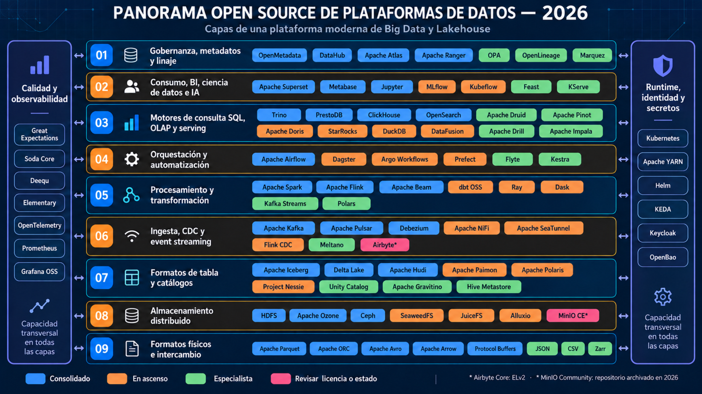

# Panorama OpenSource 2026: capas de una plataforma moderna de datos

Fecha de corte: **24 de octubre de 2026**.

Esta guía presenta un mapa de tecnologías abiertas y proyectos relacionados que pueden participar en una plataforma de Big Data o Lakehouse. La capa asignada representa la función principal del producto, no una frontera absoluta: Spark también consulta, Kafka también procesa y varios catálogos incorporan funciones de gobierno.

La selección no es un ranking ni obliga a instalar todos los componentes. Una arquitectura concreta debe elegir el conjunto mínimo que cubra sus fuentes, latencia, volumen, seguridad, operación y capacidades del equipo.

> **Imagen 4K:** seleccionar la gráfica para abrirla en resolución completa de 3840 × 2160 píxeles.

## Cómo leer el panorama

| Color | Lectura editorial |
|---|---|
| Azul | Proyecto consolidado, con adopción amplia o función de referencia. |
| Naranja | Proyecto en ascenso o con evolución especialmente activa. |
| Verde | Solución especializada cuya conveniencia depende del contexto. |
| Rosa | Revisar con atención la licencia, el estado del repositorio o la estrategia de continuidad. |

Las capacidades de **calidad y observabilidad** y de **runtime, identidad y secretos** son transversales: protegen, ejecutan u observan más de una capa. Los colores expresan una lectura editorial del panorama en la fecha de corte; no sustituyen una prueba técnica, una revisión de licencia ni una evaluación de soporte.

## 1. Gobernanza, metadatos y linaje

Esta capa permite saber qué datos existen, quién responde por ellos, cómo se clasifican, quién puede acceder y de qué procesos provienen.

| Producto | Función principal | Información oficial |
|---|---|---|
| OpenMetadata | Plataforma de catálogo, descubrimiento, linaje, calidad y gobierno de activos de datos. | [Documentación](https://docs.open-metadata.org/latest/) |
| DataHub | Plataforma de metadatos para búsqueda, propiedad, dominios, linaje e impacto de cambios. | [Documentación](https://docs.datahub.com/) |
| Apache Atlas | Gobierno y gestión de metadatos, especialmente integrado con el ecosistema Hadoop. | [Sitio oficial](https://atlas.apache.org/) |
| Apache Ranger | Administración central de políticas de autorización y auditoría para servicios de datos. | [Sitio oficial](https://ranger.apache.org/) |
| OPA | Motor general de políticas como código para autorizar solicitudes y validar configuraciones. | [Documentación](https://www.openpolicyagent.org/docs/latest/) |
| OpenLineage | Estándar abierto para emitir y compartir eventos de linaje de trabajos, ejecuciones y datasets. | [Sitio oficial](https://openlineage.io/) |
| Marquez | Servicio de metadatos de referencia que recolecta y visualiza linaje mediante OpenLineage. | [Documentación](https://marquezproject.github.io/marquez/) |

## 2. Consumo, BI, ciencia de datos e IA

Reúne las interfaces con las que analistas, científicos de datos y aplicaciones consumen resultados, experimentos, características y modelos.

| Producto | Función principal | Información oficial |
|---|---|---|
| Apache Superset | Exploración visual, tableros y consultas de inteligencia de negocios sobre fuentes SQL. | [Sitio oficial](https://superset.apache.org/) |
| Metabase | Analítica de autoservicio, preguntas, modelos semánticos y tableros para equipos de negocio. | [Documentación](https://www.metabase.com/docs/latest/) |
| Jupyter | Entorno interactivo de notebooks, código, datos, texto y visualizaciones reproducibles. | [Sitio oficial](https://jupyter.org/) |
| MLflow | Seguimiento de experimentos, empaquetado, registro y gestión del ciclo de vida de modelos. | [Documentación](https://mlflow.org/docs/latest/) |
| Kubeflow | Componentes y flujos de trabajo de aprendizaje automático ejecutados sobre Kubernetes. | [Documentación](https://www.kubeflow.org/docs/) |
| Feast | Feature store para definir, servir y mantener características consistentes para modelos. | [Documentación](https://docs.feast.dev/) |
| KServe | Inferencia escalable de modelos sobre Kubernetes, con protocolos y runtimes reutilizables. | [Documentación](https://kserve.github.io/website/) |

## 3. Motores de consulta SQL, OLAP y serving

Los motores de consulta traducen SQL u otras expresiones en planes de ejecución. Algunos federan fuentes sin almacenar datos; otros incorporan almacenamiento columnar, índices o servicios orientados a baja latencia.

| Producto | Función principal | Información oficial |
|---|---|---|
| Trino | Motor SQL distribuido y federado para consultar múltiples fuentes mediante conectores. | [Documentación](https://trino.io/docs/current/) |
| PrestoDB | Motor SQL distribuido para analizar grandes conjuntos repartidos entre fuentes heterogéneas. | [Documentación](https://www.prestodb.io/docs/current/) |
| ClickHouse | Base de datos columnar OLAP para agregaciones y consultas analíticas de alto rendimiento. | [Documentación](https://clickhouse.com/docs/en/intro) |
| OpenSearch | Motor distribuido de búsqueda, agregación y analítica sobre documentos e índices. | [Documentación](https://docs.opensearch.org/latest/) |
| Apache Druid | Base analítica distribuida orientada a eventos, series temporales y consultas interactivas. | [Documentación](https://druid.apache.org/docs/latest/) |
| Apache Pinot | Almacén OLAP distribuido para analítica en tiempo real y baja latencia sobre eventos. | [Documentación](https://docs.pinot.apache.org/) |
| Apache Doris | Base de datos analítica MPP para BI, reportes, lakehouse y análisis de baja latencia. | [Sitio oficial](https://doris.apache.org/) |
| StarRocks | Base analítica MPP orientada a consultas interactivas, vectorización y modelos de actualización. | [Documentación](https://docs.starrocks.io/) |
| DuckDB | Motor OLAP embebido que ejecuta SQL dentro de Python, R, Java u otro proceso local. | [Documentación](https://duckdb.org/docs/stable/) |
| Apache DataFusion | Motor de consulta columnar extensible escrito en Rust y basado en Apache Arrow. | [Documentación](https://datafusion.apache.org/) |
| Apache Drill | Motor SQL distribuido para explorar archivos y datos semiestructurados con esquema dinámico. | [Documentación](https://drill.apache.org/docs/) |
| Apache Impala | Motor SQL MPP para consultas interactivas sobre Hadoop, HDFS y almacenamiento compatible. | [Sitio oficial](https://impala.apache.org/) |

> **Distinción útil:** Trino y PrestoDB federan fuentes; DuckDB se ejecuta embebido; Druid y Pinot priorizan serving analítico de baja latencia; ClickHouse, Doris y StarRocks combinan motor y almacenamiento analítico. No son sustitutos directos en todos los escenarios.

## 4. Orquestación y automatización

Coordina dependencias, calendarios, eventos, reintentos, recursos y observabilidad operacional de los pipelines.

| Producto | Función principal | Información oficial |
|---|---|---|
| Apache Airflow | Orquestación de flujos por DAG definidos en Python, especialmente para procesos batch. | [Documentación](https://airflow.apache.org/docs/) |
| Dagster | Orquestador centrado en activos de datos, particiones, pruebas y observabilidad del pipeline. | [Documentación](https://docs.dagster.io/) |
| Argo Workflows | Motor de flujos nativo de Kubernetes basado en recursos declarativos y contenedores. | [Documentación](https://argo-workflows.readthedocs.io/) |
| Prefect | Orquestación en Python con estados, reintentos, despliegues y ejecución dinámica. | [Documentación](https://docs.prefect.io/) |
| Flyte | Plataforma de workflows reproducibles para datos y aprendizaje automático sobre Kubernetes. | [Documentación](https://docs.flyte.org/en/latest/) |
| Kestra | Orquestador declarativo y orientado a eventos para coordinar tareas, datos y aplicaciones. | [Documentación](https://kestra.io/docs) |

## 5. Procesamiento y transformación

Contiene motores y bibliotecas que limpian, combinan, agregan o enriquecen datos en batch, streaming, SQL o Python distribuido.

| Producto | Función principal | Información oficial |
|---|---|---|
| Apache Spark | Motor distribuido para batch, SQL, streaming, ciencia de datos y aprendizaje automático. | [Documentación](https://spark.apache.org/docs/latest/) |
| Apache Flink | Motor distribuido para procesamiento con estado de flujos y datos acotados. | [Documentación](https://nightlies.apache.org/flink/flink-docs-stable/) |
| Apache Beam | Modelo unificado para definir pipelines portables y ejecutarlos en diferentes runners. | [Documentación](https://beam.apache.org/documentation/) |
| dbt OSS | Transformación SQL gestionada como código, con dependencias, pruebas y documentación. | [Documentación](https://docs.getdbt.com/) |
| Ray | Runtime de Python distribuido para tareas, actores, entrenamiento y cargas de IA. | [Documentación](https://docs.ray.io/en/latest/) |
| Dask | Paralelización de colecciones y tareas Python en un equipo o un clúster. | [Documentación](https://docs.dask.org/en/stable/) |
| Kafka Streams | Biblioteca Java para procesar y materializar flujos almacenados en Apache Kafka. | [Documentación](https://kafka.apache.org/documentation/streams/) |
| Polars | Motor de DataFrames columnar escrito en Rust, con expresiones y ejecución diferida. | [Documentación](https://docs.pola.rs/) |

## 6. Ingesta, CDC y event streaming

Mueve datos entre sistemas, captura cambios de bases transaccionales y desacopla productores de consumidores mediante eventos.

| Producto | Función principal | Información oficial |
|---|---|---|
| Apache Kafka | Plataforma distribuida de eventos basada en logs particionados, productores y consumidores. | [Documentación](https://kafka.apache.org/documentation/) |
| Apache Pulsar | Mensajería y streaming distribuido con separación entre serving y almacenamiento. | [Documentación](https://pulsar.apache.org/docs/) |
| Debezium | Conjunto de conectores CDC que convierte cambios de bases de datos en eventos. | [Documentación](https://debezium.io/documentation/) |
| Apache NiFi | Diseño visual y ejecución de flujos de datos con enrutamiento, procedencia y control. | [Documentación](https://nifi.apache.org/documentation/) |
| Apache SeaTunnel | Plataforma de integración para sincronizar datos batch y streaming entre conectores. | [Documentación](https://seatunnel.apache.org/docs/) |
| Flink CDC | Conectores y pipelines de captura de cambios construidos sobre Apache Flink. | [Documentación](https://nightlies.apache.org/flink/flink-cdc-docs-stable/) |
| Meltano | Framework extensible de integración y ELT basado en plugins, configuración y CLI. | [Documentación](https://docs.meltano.com/) |
| Airbyte | Plataforma de conectores para replicación ELT; revisar el alcance de ELv2 antes de adoptarla. | [Documentación](https://docs.airbyte.com/) · [Licencias](https://github.com/airbytehq/airbyte/blob/master/docs/community/licenses/README.md) |

## 7. Formatos de tabla y catálogos técnicos

Los formatos de tabla agregan transacciones, snapshots y evolución de esquema sobre archivos. Los catálogos publican tablas, versiones, ubicaciones y credenciales para varios motores.

| Producto | Función principal | Información oficial |
|---|---|---|
| Apache Iceberg | Formato abierto de tablas con snapshots, evolución de esquema y particionado oculto. | [Documentación](https://iceberg.apache.org/docs/latest/) |
| Delta Lake | Capa de tablas con log transaccional, control de versiones y operaciones ACID. | [Documentación](https://docs.delta.io/latest/) |
| Apache Hudi | Formato y plataforma de tablas para actualizaciones incrementales y procesamiento continuo. | [Documentación](https://hudi.apache.org/docs/overview/) |
| Apache Paimon | Formato de lakehouse orientado a streaming, actualizaciones y consultas batch. | [Documentación](https://paimon.apache.org/docs/master/) |
| Apache Polaris | Catálogo abierto compatible con la API REST de Iceberg y acceso multi-motor. | [Documentación](https://polaris.apache.org/) |
| Project Nessie | Catálogo transaccional con ramas y etiquetas para versionar metadatos del lakehouse. | [Documentación](https://projectnessie.org/nessie-latest/) |
| Unity Catalog | Catálogo abierto para tablas, archivos, funciones y modelos mediante APIs interoperables. | [Documentación](https://docs.unitycatalog.io/) |
| Apache Gravitino | Metadatos federados para gobernar catálogos y activos distribuidos entre sistemas. | [Documentación](https://gravitino.apache.org/docs/latest/) |
| Hive Metastore | Servicio histórico de metadatos para tablas, particiones y esquemas del ecosistema Hadoop. | [Documentación](https://hive.apache.org/) |

## 8. Almacenamiento distribuido

Proporciona persistencia escalable en forma de objetos, archivos o bloques. En arquitecturas desacopladas, varios motores comparten los mismos datos sin pertenecer al sistema de almacenamiento.

| Producto | Función principal | Información oficial |
|---|---|---|
| HDFS | Sistema de archivos distribuido de Hadoop, optimizado para archivos grandes y lectura secuencial. | [Documentación](https://hadoop.apache.org/docs/stable/hadoop-project-dist/hadoop-hdfs/HdfsDesign.html) |
| Apache Ozone | Almacenamiento de objetos distribuido diseñado para el ecosistema Hadoop. | [Documentación](https://ozone.apache.org/docs/user-guide/) |
| Ceph | Plataforma distribuida que ofrece almacenamiento de objetos, bloques y archivos. | [Documentación](https://docs.ceph.com/en/latest/) |
| SeaweedFS | Sistema distribuido para objetos, archivos y blobs con un diseño ligero y escalable. | [Repositorio oficial](https://github.com/seaweedfs/seaweedfs) |
| JuiceFS | Sistema de archivos POSIX distribuido que separa metadatos y contenido en almacenamiento de objetos. | [Documentación](https://juicefs.com/docs/community/introduction/) |
| Alluxio | Capa virtual de acceso y caché que acerca datos remotos a los motores de cómputo. | [Documentación](https://documentation.alluxio.io/) |
| MinIO CE | Servidor de objetos compatible con S3; el repositorio comunitario fue archivado en abril de 2026. | [Repositorio oficial](https://github.com/minio/minio) |

## 9. Formatos físicos e intercambio

Definen cómo se representan los datos en archivos, memoria, mensajes o interfaces entre procesos.

| Producto o formato | Función principal | Información oficial |
|---|---|---|
| Apache Parquet | Formato columnar para analítica, compresión y lectura selectiva de columnas. | [Sitio oficial](https://parquet.apache.org/) |
| Apache ORC | Formato columnar con índices y estadísticas, utilizado ampliamente en Hadoop. | [Sitio oficial](https://orc.apache.org/) |
| Apache Avro | Serialización orientada a filas con esquemas y evolución para archivos y eventos. | [Documentación](https://avro.apache.org/docs/current/) |
| Apache Arrow | Especificación columnar en memoria para intercambio eficiente entre lenguajes y motores. | [Documentación](https://arrow.apache.org/docs/) |
| Protocol Buffers | Serialización binaria con esquemas para mensajes y contratos entre servicios. | [Documentación](https://protobuf.dev/) |
| JSON | Formato textual interoperable para objetos, arreglos y valores simples. | [Especificación](https://www.json.org/json-en.html) |
| CSV | Representación tabular de texto delimitado; requiere acordar codificación, separador y tipos. | [RFC 4180](https://www.rfc-editor.org/rfc/rfc4180) |
| Zarr | Formato fragmentado para arreglos N-dimensionales, adecuado para acceso paralelo y almacenamiento cloud. | [Documentación](https://zarr.readthedocs.io/) |

## Capacidad transversal: calidad y observabilidad

Estas herramientas verifican expectativas, detectan anomalías y exponen métricas, trazas o tableros para múltiples capas.

| Producto | Función principal | Información oficial |
|---|---|---|
| Great Expectations | Validación de datos mediante expectativas, checkpoints y documentación de resultados. | [Documentación](https://docs.greatexpectations.io/docs/home/) |
| Soda Core | Pruebas de calidad y monitoreo declarativo ejecutado contra fuentes de datos. | [Documentación](https://docs.soda.io/soda-core/) |
| Deequ | Biblioteca de calidad de datos sobre Spark para restricciones, métricas y perfiles. | [Repositorio oficial](https://github.com/awslabs/deequ) |
| Elementary | Observabilidad orientada a dbt para pruebas, frescura, volumen, esquema y linaje. | [Documentación](https://docs.elementary-data.com/) |
| OpenTelemetry | Estándar y herramientas para producir trazas, métricas y logs de forma interoperable. | [Documentación](https://opentelemetry.io/docs/) |
| Prometheus | Recolección y consulta de métricas temporales con reglas y alertas. | [Documentación](https://prometheus.io/docs/) |
| Grafana OSS | Visualización y exploración de métricas, logs, trazas y otras fuentes. | [Sitio oficial](https://grafana.com/oss/grafana/) |

## Capacidad transversal: runtime, identidad y secretos

Proporciona ejecución, empaquetado, escalamiento, autenticación y protección de credenciales para los demás componentes.

| Producto | Función principal | Información oficial |
|---|---|---|
| Kubernetes | Orquestación declarativa de contenedores, servicios, configuración y almacenamiento. | [Documentación](https://kubernetes.io/docs/home/) |
| Apache YARN | Gestión de recursos y planificación de aplicaciones en clústeres Hadoop. | [Documentación](https://hadoop.apache.org/docs/stable/hadoop-yarn/hadoop-yarn-site/YARN.html) |
| Helm | Empaquetado, parametrización e instalación de aplicaciones sobre Kubernetes. | [Documentación](https://helm.sh/docs/) |
| KEDA | Autoescalamiento de cargas Kubernetes a partir de colas, eventos y métricas externas. | [Documentación](https://keda.sh/docs/) |
| Keycloak | Gestión de identidades, inicio de sesión único, federación y protocolos OAuth/OIDC/SAML. | [Documentación](https://www.keycloak.org/documentation) |
| OpenBao | Gestión de secretos, credenciales dinámicas, cifrado e identidades de máquinas. | [Documentación](https://openbao.org/docs/) |

## Criterios para escoger componentes

1. **Comenzar por el caso de uso:** batch, streaming, BI interactivo, búsqueda, IA o una combinación explícita.
2. **Separar datos y cómputo cuando sea conveniente:** formatos abiertos y catálogos interoperables reducen el acoplamiento con un motor.
3. **Definir objetivos medibles:** volumen, concurrencia, latencia, recuperación, costo y tiempo de operación.
4. **Revisar licencia y salud del proyecto:** confirmar gobernanza, frecuencia de versiones, seguridad y condiciones de redistribución.
5. **Probar la integración completa:** no basta con un benchmark aislado; se deben medir conectores, catálogo, formato, almacenamiento, seguridad y observabilidad.
6. **Evitar duplicación accidental:** dos herramientas de la misma subcategoría requieren una razón operacional concreta.

## Referencias de contexto

- [LF AI & Data Landscape](https://landscape.lfai.foundation/): panorama de proyectos de datos e inteligencia artificial de la Linux Foundation.
- [CNCF Cloud Native Landscape](https://landscape.cncf.io/): proyectos de infraestructura y operación cloud native.
- [Apache Software Foundation](https://projects.apache.org/): directorio de proyectos y comunidades Apache.
