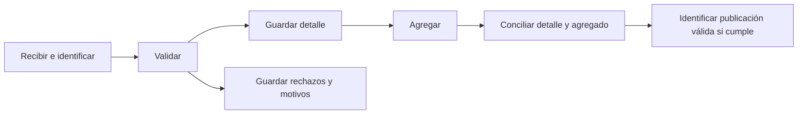
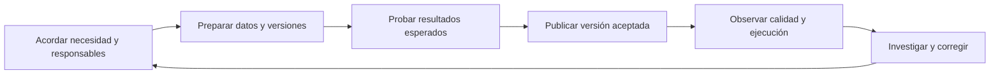

# Data pipelines y DataOps

Material conceptual de las clases 09 y 10. La aplicación corresponde a [E12](../talleres/E12.md), con sus cuatro criterios mínimos y sin nuevas ponderaciones. Esta guía acompaña las presentaciones y permanece disponible al clonar el repositorio.

## Por qué necesitamos un pipeline

Dos personas preparan un conteo con el mismo archivo. Una elimina territorios vacíos y otra los conserva. Obtienen cifras diferentes aunque ambos programas terminan sin errores. Para explicar la diferencia necesitamos conocer los datos, las reglas y las operaciones aplicadas.

Un **pipeline** organiza tareas que reciben datos y producen un resultado utilizable. Sus dependencias establecen qué debe estar disponible antes de iniciar cada tarea. Una **ejecución** aplica ese diseño a unas entradas concretas y conserva evidencia de sus resultados.

Conservar originales permite revisar las decisiones sin perder la evidencia recibida. Separar rechazos explica qué observaciones quedaron fuera. Comprobar las salidas evita entregar archivos incompletos como resultados válidos. Repetir el proceso permite detectar acumulaciones accidentales.

## Cómo se organiza el trabajo

| Concepto | Significado | Aplicación en el caso |
|---|---|---|
| Entrada | Datos identificados para una ejecución | Archivo, fuente, corte y huella |
| Tarea | Una operación concreta | Validar el período |
| Dependencia | Condición previa para ejecutar | El agregado requiere detalle válido |
| Producto | Salida que otra tarea o persona utiliza | Detalle y agregado Parquet |
| Control | Comparación con un resultado esperado | Igualdad por grupo y total |

El flujo de datos explica qué recibe y entrega cada etapa. El flujo de control explica qué permite continuar. Un **DAG** representa tareas y dependencias dirigidas sin ciclos. Puede tener ramas, como guardar detalle y guardar rechazos después de validar. La ejecución local puede recorrerlas secuencialmente.

La **orquestación** coordina orden, condiciones, estados y respuesta al fallo. Evita, por ejemplo, que una tarea continúe con la tabla de una ejecución anterior tras fallar la nueva validación. Airflow ejemplifica una plataforma para operar flujos. El curso expresa esas condiciones localmente, sin exigir su instalación.

## Por qué necesitamos DataOps

Un programa puede terminar con un corte incompleto. Una corrección de la fuente puede cambiar legítimamente una cifra. Un equipo nuevo puede desconocer la regla que produjo una publicación. Por eso necesitamos prácticas compartidas que sostengan la confianza en cada ejecución.

**DataOps** organiza colaboración, cambios, pruebas y operación. El equipo acuerda el significado del resultado, identifica datos y reglas, comprueba cambios antes de publicar y utiliza las evidencias de operación para corregir problemas.

Este ciclo describe la mejora del trabajo del equipo. El DAG anterior describe las dependencias de una ejecución. Son dos esquemas con propósitos distintos.

| Necesidad | Práctica | Evidencia en E12 |
|---|---|---|
| Explicar un cambio | Identificar datos, reglas y configuración | Manifiesto, versión de código/reglas, parámetros y bibliotecas |
| Comprobar una regla | Probar primero un caso conocido | Tabla de resultados esperados y control |
| Entender una ejecución | Registrar estado, conteos y causas | Registro vinculado al candidato |
| Atender un fallo | Acordar responsable y acción | Ficha de auditoría con revisión posterior |
| Evitar duplicación | Repetir sin acumular el mismo efecto | Comparación del contenido de dos ejecuciones |

Una descarga interrumpida puede admitir un reintento limitado. Una columna necesaria ausente requiere revisar fuente o contrato. Repetir sin corregir no resuelve ese problema. La **idempotencia** evita que repetir una operación duplique su efecto esperado. En el ejercicio, dos ejecuciones del mismo corte deben conservar el contenido previsto, incluidas las multiplicidades del detalle. Comparar solo totales o los bytes de Parquet no demuestra esa igualdad.

## Esquemas industriales

Estos patrones aparecen en documentación actual de plataformas y proyectos. No representan un ranking de adopción ni alternativas excluyentes.

| Esquema | Recorrido | Razón para considerarlo | Ejemplo de herramienta |
|---|---|---|---|
| ETL | Extraer, transformar, cargar | Preparar o filtrar antes del destino de consumo | AWS Glue con Spark |
| ELT | Extraer, cargar, transformar dentro del destino | Aprovechar el motor del almacén para transformar | Ingesta más modelos SQL con dbt |
| Medallion | Bronze originales, Silver validados, Gold para consumo | Separar conservación, preparación y productos | Spark en un lakehouse |
| CDC | Cambios de la base, eventos, aplicación en el destino | Actualizar con menor demora y evitar releer todo el origen | Debezium, con Kafka como opción de transporte |

ETL y ELT describen orden y lugar de transformación. Medallion organiza capas y puede usar lotes o eventos. CDC captura cambios y exige definir cómo el destino maneja orden, duplicados y eliminaciones. La orquestación y las prácticas DataOps atraviesan estos esquemas. Nombrar carpetas Bronze/Silver/Gold no acredita calidad ni una plataforma de producción.

Parquet conserva valores y columnas. Un formato de tabla como Iceberg gestiona metadatos que identifican los archivos de un estado de tabla. Sus snapshots ayudan a consultar estados retenidos tras correcciones. Hudi es otra referencia de gestión de tablas y actualizaciones. Estos formatos complementan las pruebas y la orquestación. En E12 se mantiene Parquet local; la demostración Iceberg es docente y requiere entorno preparado.

## Ejemplo desarrollado

Pregunta: contar reportes por período y territorio. Cada fila del ejemplo representa un reporte distinto. Las cifras son hipotéticas y no describen resultados observados de Supersalud.

| Fila | Período | Territorio | Regla aplicada |
|---|---|---|---|
| 1 | 2024-I | Bogotá | Aceptar |
| 2 | 2024-I | Bogotá | Aceptar |
| 3 | 2024-I | Boyacá | Aceptar |
| 4 | 2024-I | Ausente | Aceptar como SIN_INFORMAR |
| 5 | 2024-II | Bogotá | Aceptar |
| 6 | Inválido | Boyacá | Rechazar con motivo |

La regla conserva la ausencia territorial para no ocultar observaciones sin esa información. El período inválido impide asignar la fila al corte del ejemplo. Estas decisiones deben adaptarse al contrato de la fuente real.

Se leen 6 filas, se aceptan 5 y se rechaza 1. El agregado contiene cuatro grupos: 2024-I/Bogotá = 2, 2024-I/Boyacá = 1, 2024-I/SIN_INFORMAR = 1 y 2024-II/Bogotá = 1. La consulta sobre el detalle debe reproducir cada grupo y el total 5.

Si intercambiamos los conteos de Bogotá y Boyacá, el total sigue en 5 pero la publicación es incorrecta. Si anexamos otra vez el mismo corte, duplicamos el efecto de la primera ejecución. Por eso comprobamos grupos y contenido, además del total.

Una corrección legítima de Boyacá a Bogotá cambia la entrada y su huella: el primer grupo pasa a 3 y el segundo a 0. Conservamos la versión anterior, investigamos la causa, probamos el nuevo candidato y registramos cuál puede consumirse. Ya no esperamos igualdad entre las dos versiones de entrada.

## Ejercicios guiados

1. **Diseñar el pipeline.** Dibujar tareas y dependencias del ejemplo. Explicar por qué existe cada tarea, qué recibe y qué entrega. Incluir rechazados y condición de publicación. Producto: esquema explicado. Comprobación: si falta la entrada, la validación no puede comenzar.
2. **Atender incidentes.** Decidir qué hacer ante una descarga interrumpida, dos grupos distintos con igual total, diez filas después de reejecutar y un aumento de rechazos. Producto: causa posible, acción, evidencia y responsable. Comprobación: distinguir una señal observada de una causa demostrada.
3. **Definir una prueba.** Calcular la salida esperada de las seis filas, proponer una modificación deliberada y explicar qué control debe detectarla. Producto: tabla esperada y fallo detectable. Comprobación: 6 = 5 + 1, cuatro grupos y comparación de sus medidas.

El viernes son ejercicios formativos sin entrega calificada. El sábado se implementan los pasos de E12 con operaciones conocidas. Cada sección explica primero para qué sirve, muestra la operación y comprueba su salida. Los productos existentes acreditan las prácticas DataOps, sin nuevos criterios ponderados.

## Material disponible y límites

El enunciado E12, esta guía y la [solución integrada de referencia](../soluciones/E12_solucion.ipynb) están disponibles. La solución relee candidatos, concilia cada grupo y el total, conserva dos registros y compara el contenido de ambas ejecuciones. Los notebooks 02 y 03 mantienen las operaciones parciales que sirvieron de antecedente. La demostración Iceberg continúa separada y requiere un entorno preparado; el script `talleres.py modelo` y sus métricas históricas no validan el E12 vigente.

## Fuentes primarias

- [Airflow: DAG, tareas y dependencias](https://airflow.apache.org/docs/apache-airflow/stable/core-concepts/dags.html).
- [Manifiesto DataOps](https://dataopsmanifesto.org/en/).
- [Great Expectations: validación en el pipeline](https://docs.greatexpectations.io/docs/reference/learn/gx_in_your_data_pipeline/gx_in_your_data_pipeline_lp/).
- [AWS Glue: ETL y procesamiento](https://docs.aws.amazon.com/glue/latest/dg/what-is-glue.html).
- [dbt: pipeline ELT](https://www.getdbt.com/blog/elt-pipeline).
- [Azure Databricks: arquitectura Medallion](https://learn.microsoft.com/en-us/azure/databricks/lakehouse/medallion).
- [Debezium: arquitectura CDC](https://debezium.io/documentation/reference/stable/architecture.html).
- [Iceberg: consultas Spark](https://iceberg.apache.org/docs/latest/spark-queries/).
- [Apache Hudi](https://hudi.apache.org/docs/overview/).
